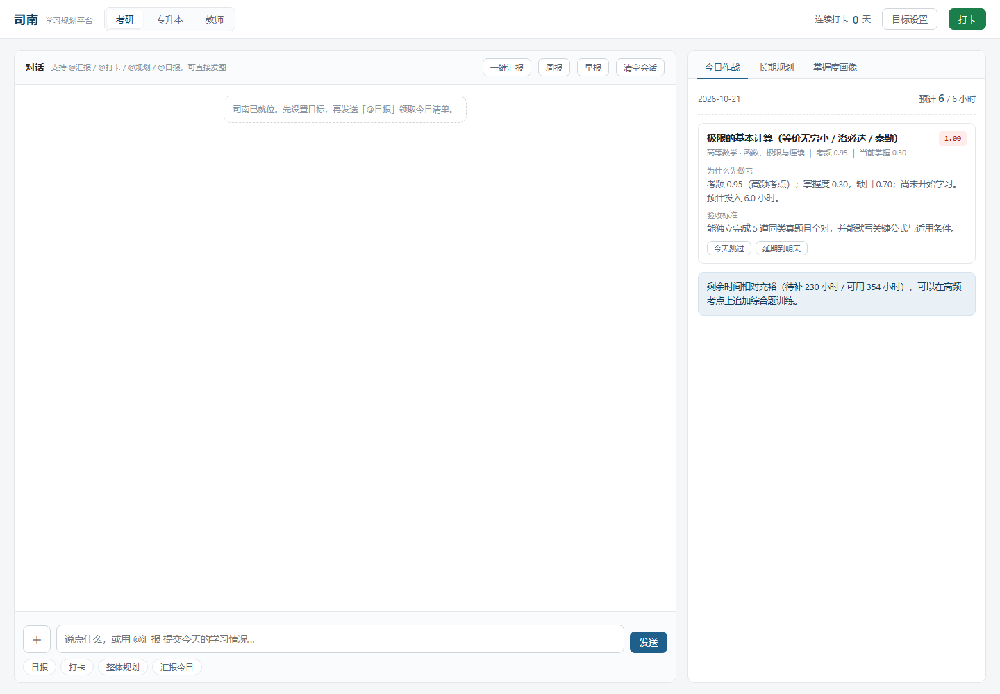
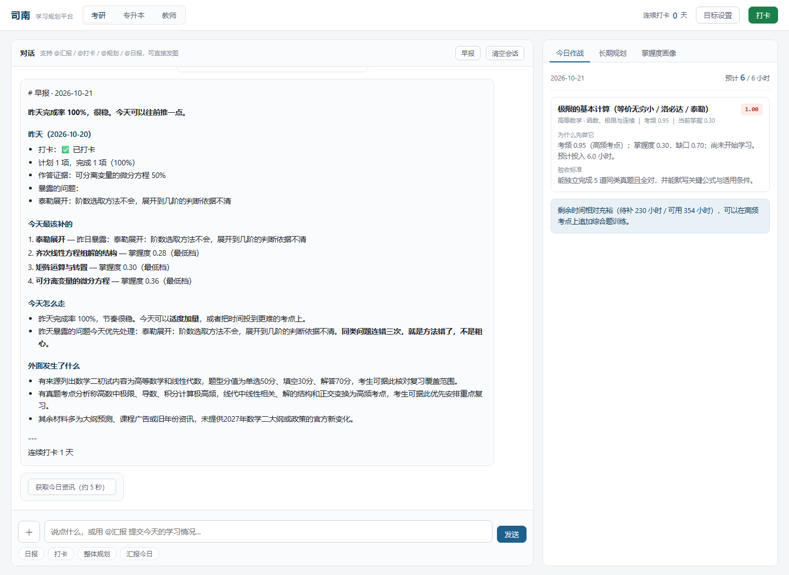
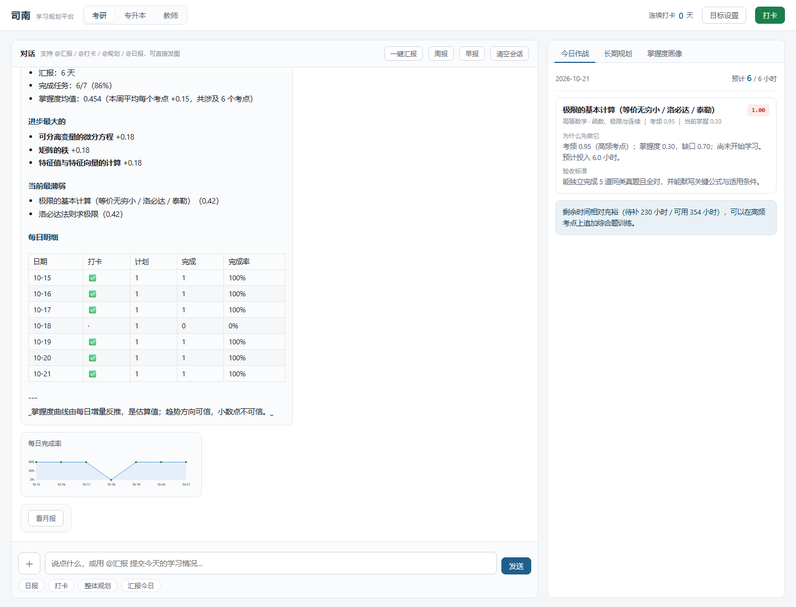
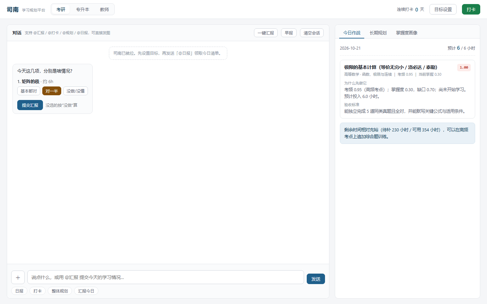

# 司南 · 多身份学习规划 Agent

> 一个带反馈回路的学习规划系统。**不是答疑，是取舍决策。**


**8100 行 Python · 19 个 API 路径 · 3 个身份包 · 20 节端到端自检**

---

## 它解决什么问题

市面上的学习 AI 大多做**答疑**（这题怎么做）。但备考真正难的不是解题，是**取舍**：

- 今晚两小时，先看极限还是线代？
- 昨天说要做完的，为什么没做完？
- 这周到底有没有进步，还是原地打转？

司南回答的是这三个问题：

```
定目标 → 长线规划 → 今日作战清单 → 打卡/汇报 → 画像更新 → 重排明日 → 早报/周报
                        ↑                                    │
                        └──────────── 反馈回路 ───────────────┘
```

---

## 核心能力

| 能力 | 做什么 | 关键实现 |
|---|---|---|
| **长线规划** | 基础 / 强化 / 冲刺三阶段里程碑 | 按剩余天数 + 考点难度分配 |
| **今日清单** | 按"提分性价比"排序，附理由与验收标准 | `Σ wᵢ·fᵢ(ctx, kp)` 确定性打分 + 时间背包装箱 |
| **打卡 / 汇报** | 打卡=做没做（1 秒）；汇报=做得怎样（可拍照） | 打卡**不触发**重规划，汇报才触发 |
| **画像更新** | 掌握度指数平滑，暴露问题归入长期记忆 | LangGraph Store，跨会话跨月份 |
| **每日早报** | 昨日复盘 + 薄弱点 + 今日清单 + 考研资讯 | 事实由算法算，只有资讯走模型 |
| **周报 / 月报** | 打卡率、完成率、进步项、停滞项、趋势曲线 | 每日增量累计，按考点归一 |
| **对话问答** | 9 个工具：本地知识库、联网检索、识图、笔记摘要、画像读写 | ReAct Agent + RAG（BM25 + 向量 + RRF） |
| **多身份** | 考研 / 专升本 / 教师，各自考点树与权重 | **加身份 = 加一个文件，引擎零改动** |

---

## 界面预览

<table>
<tr>
<td width="50%">

<br><sub><b>今日清单</b> — 每项标注「为什么先做它」「验收标准」，可跳过或延期</sub>
</td>
<td width="50%">

<br><sub><b>每日早报</b> — 昨日复盘 / 今天最该补的 / 今日清单 / 考研资讯</sub>
</td>
</tr>
<tr>
<td>

<br><sub><b>周报</b> — 打卡率 · 完成率 · 进步项 · 每日明细表 · 完成率趋势</sub>
</td>
<td>

<br><sub><b>一键汇报</b> — 三档点选（基本都对 / 对一半 / 没做），10 秒完成</sub>
</td>
</tr>
</table>

---

## 架构

```
┌─ 身份层 roles/ ─── 可插拔策略 ───────────────────────────┐
│  kaoyan（考研 · 69 考点 · 4 因子）                        │
│  zhuanshengben（专升本 · 64 考点 · 5 因子）               │
│  teacher（教师 · 6 考点 · 占位）                          │
│  新增身份 = 新建一个文件 + 注册一行，引擎零改动            │
└────────────────────┬─────────────────────────────────────┘
                     │ 目标模型 / 考点树 / 因子 / 权重 / 提示词
┌────────────────────▼─────────────────────────────────────┐
│  引擎层 core/ ─── 与身份完全无关 ────────────────────────  │
│  意图路由 → 规划器 → 优先度引擎 → 汇报解析 → 重规划        │
│  graph.py：StateGraph 五路条件边 + interrupt 人工确认      │
│  report_agent.py：汇报子图（parse → 追问环 → apply）       │
└────────────────────┬─────────────────────────────────────┘
                     │
┌────────────────────▼─────────────────────────────────────┐
│  能力层 ─────────────────────────────────────────────────  │
│  kb/（RAG 知识库）· briefing（早报）· period_report（周报）│
│  memory_store（长期记忆）· tools/（9 个 Agent 工具）       │
└────────────────────┬─────────────────────────────────────┘
                     │
┌────────────────────▼─────────────────────────────────────┐
│  数据层 db/ ─── 全部带 user_id + role 维度 ──────────────  │
│  SQLite：画像 / 考点 / 计划 / 打卡汇报 / 掌握度 / 早报     │
│  LangGraph checkpointer（会话）+ Store（长期画像）         │
└──────────────────────────────────────────────────────────┘
```

### 优先度引擎（项目灵魂）

```python
priority = Σ wᵢ · fᵢ(ctx, kp)
```

| 身份 | 因子与权重 |
|---|---|
| 考研 | 考频 `+0.40` ｜ 掌握度缺口 `+0.35` ｜ 遗忘紧急度 `+0.15` ｜ 时间成本 `-0.10` |
| 专升本 | 考频 `+0.38` ｜ 缺口 `+0.38` ｜ 紧急度 `+0.14` ｜ **难度惩罚 `-0.06`** ｜ 成本 `-0.08` |

**四个因子的数据全部来自数据库，零模型调用。** 同一个输入永远得到同一个顺序——这是"可解释"的前提。

专升本包还实现了 `adjust_weights` 动态调权钩子：距考试 >180 天时上调缺口权重（补基础），≤60 天时上调考频、加重难度惩罚（冲刺抓高频）。

---

## 六个关键设计决策

### 1. 为什么排序交给算法，不交给 Agent

学习规划的核心卖点是**可解释**。如果让模型自由排序，用户今天看到"极限第一"，明天看到"矩阵第一"，还说不清为什么——信任立刻崩。

> **凡是需要能当场解释"为什么是这个顺序"的地方，就不该有 Agent。**

Agent 只在开放域问答里出现，因为那里本来就答不出标准答案。五条业务分支里，只有 1 条交给它。

### 2. 为什么加身份不用改引擎

`RolePack` 抽象只要求实现三个方法：`build_kp_tree()` / `reporter_prompt()` / `system_prompt()`。引擎只依赖这个接口，不认识任何具体身份。

**验证方式**：专升本身份包从占位到可用（7 → 64 个考点、4 → 5 个因子、启用动态调权），改动**全部集中在 `roles/zhuanshengben.py` 一个文件**，引擎、规划器、仓储、API、图、子图一行未动。

### 3. 为什么记忆要分两层

| | checkpointer | Store |
|---|---|---|
| 隔离键 | `thread_id` | namespace 元组 |
| 生命周期 | 会话内 | 跨会话、跨月份 |
| 回答 | "这次对话说到哪了" | "这个人是谁、他学到哪了" |
| 库 | `checkpoints.db` | `memory_store.db` |

**只有"关于用户本人的记忆"进 Store**（掌握度）。考点树、计划、打卡是"系统运作的业务记录"，留在 SQL——它们需要领域 schema、幂等、状态机和聚合。

### 4. 为什么 RAG 要稀疏 + 稠密两条路

| | 稀疏 BM25 | 稠密向量 |
|---|---|---|
| 打分依据 | 词是否出现 | 语义是否接近 |
| 可解释 | 能说清哪几个词命中 | 只有一个数字 |
| 短板 | 同义词（"求导" ≠ "导数"） | 生僻词、新词 |

实测证据：查「求导法则有哪些」时，BM25 被"法则"误导排到了「矩阵运算与转置」，而稠密正确命中「导数与微分的定义」。**RRF 融合后错误被纠正**——它只融合排名不融合分数（`Σ 1/(60+rank)`），免调参、抗单路噪声。

### 5. 为什么打卡不触发重规划

| | 打卡 | 汇报 |
|---|---|---|
| 回答 | 做没做（二元） | 做得怎样（有内容） |
| 成本 | 1 秒 | 30 秒 ~ 2 分钟 |
| 触发重规划 | **否** | **是** |

打卡的信息量不足以支撑任务排序变化。若打卡就重排，用户会发现计划天天变，信任度会崩。

另有三条稳定性保护：**只改未来不改今天** · **偏差 ≤10% 不重排** · **顺延而非丢弃**。

### 6. 为什么定时任务不放在 Web 进程里

uvicorn 多 worker 时，每个进程都会各起一个调度器，同一分钟生成 N 份早报；进程重启还会丢掉"今天还没生成"的状态。

> **定时任务的正确归属是操作系统，不是 Web 进程。**

所以项目只提供一个幂等的命令行入口 `scripts/daily_briefing.py`，由 cron / 任务计划程序调用。

---

## 工程数据（都有实测支撑）

| 指标 | 数值 |
|---|---|
| 代码量 | **8100 行** Python（44 个文件）+ 386 行知识库文档 |
| API 端点 | **19 个路径 / 21 个操作方法**（chat / plan / log / profile / oss / briefing） |
| 身份包 | 3 个，考点 **139 个**（69 + 64 + 6） |
| 知识库 | 3 篇文档 → **65 个检索块**，BM25 + bge-m3 向量 + RRF |
| Agent 工具 | **9 个** |
| 端到端自检 | **20 节**，覆盖 L1~L16 全链路 |

### 质量证据

**故障注入**（专门验证"依赖挂了会怎样"）：

| 注入的故障 | 系统表现 |
|---|---|
| 解析模型整体抛异常 | 降级为追问「自动解析暂不可用，请用文字描述」，**不是把 RuntimeError 甩给用户** |
| Tavily 额度耗尽 | 早报资讯降级为空，复盘/薄弱点/建议三段完整保留 |
| 未知身份包 | 抛 KeyError → 400，不是 500 |

**并发压测**（20 线程 / 40 请求）：

```
吞吐 11.9 req/s · 40/40 全部成功 · 0 条 database is locked · 服务端错误日志 0 条
```

并发梯度测试定位到瓶颈：**吞吐恒定在 ~15 req/s 不随并发增长，延迟线性上升**（65ms → 1278ms），对照不碰数据库的 `/health`（276 req/s 几乎不受影响），锁定为 **SQLite 串行写**。优化路径：WAL 模式 → 减少写次数 → 换 PostgreSQL；**不建议加多 worker**（文件锁会加剧竞争）。

---

## 快速开始

```bash
# 1. 安装依赖（使用 uv）
uv sync

# 2. 配置 .env（模板见 .env.example）
#    至少需要：DEEPSEEK_API_KEY（推理）、SILICONFLOW_API_KEY（embedding）
#    Tavily / 智谱视觉 为可选，缺失时对应功能自动降级
cp .env.example .env

# 3. 启动（cwd 必须是 src）
cd src
../.venv/Scripts/python.exe -m uvicorn app.main:app --port 8001
# 浏览器打开 http://127.0.0.1:8001
```

### 生产部署

```bash
docker build -t sinan .
docker run -p 8001:8001 --env-file .env sinan
```

内置三项上线能力：`GET /health` 健康检查（**不探外部模型**，探活不该花钱）· `SINAN_API_TOKEN` 访问令牌 · `SINAN_ALLOWED_ORIGINS` CORS 收敛。

---

## 项目结构

```
src/app/
├── agent/
│   ├── core/
│   │   ├── router.py         # 意图路由（6 种意图）
│   │   ├── priority.py       # 优先度引擎 + 时间背包装箱
│   │   ├── planner.py        # 规划器 + 计划稳定性 + 重规划
│   │   ├── graph.py          # ★ 业务编排图（StateGraph + interrupt）
│   │   ├── reporter.py       # 汇报解析（视觉 + 结构化抽取）
│   │   └── service.py        # 业务流程编排
│   ├── report_agent.py       # ★ 汇报子图（parse → 追问环 → apply）
│   ├── briefing.py           # ★ 每日早报
│   ├── period_report.py      # ★ 周报 / 月报
│   ├── roles/                # ★ 身份包（可插拔）
│   │   ├── base.py           #   RolePack 抽象 + 因子 + 注册表
│   │   ├── kaoyan.py         #   考研（69 考点）
│   │   ├── zhuanshengben.py  #   专升本（64 考点）
│   │   └── teacher.py        #   教师（占位）
│   ├── kb/                   # ★ RAG 知识库
│   │   ├── chunker.py        #   文档加载 + 分块
│   │   ├── embeddings.py     #   向量化（可插拔 provider）
│   │   ├── retriever.py      #   BM25 + 向量 + RRF
│   │   └── documents/        #   考点精讲（markdown）
│   ├── tools/                # 9 个 Agent 工具
│   └── sinan_agent.py        # 主 Agent
├── api/v1/                   # profile / plan / log / chat / briefing / oss
├── db/
│   ├── models.py             # DDL（6 张业务表）
│   ├── repository.py         # 仓储层（业务层不写 SQL）
│   └── memory_store.py       # ★ 长期记忆 Store
├── models/schemas.py
├── static/                   # 前端（单文件 HTML，零依赖零构建）
└── main.py                   # 入口 + 健康检查 + 令牌中间件
```

---

## 测试

```bash
# 20 节端到端自检（覆盖规划 / 图 / 中断 / 子图 / Store / RAG / 多租户 / 早报 / 故障注入）
.venv/Scripts/python.exe scripts/selftest_engine.py

# 导出图结构
.venv/Scripts/python.exe scripts/trace_graph.py

# 生成今日早报
.venv/Scripts/python.exe scripts/daily_briefing.py --user default --role kaoyan
```

---

## 已知限制（诚实清单）

| 限制 | 现状 | 影响 |
|---|---|---|
| **无用户体系** | `user_id` 由前端传，访问令牌是"门锁"不是"鉴权" | 公网部署前需要补充身份认证 |
| **前端不支持令牌** | 开启 `SINAN_API_TOKEN` 后前端请求会 401 | 目前定位是本地/单机使用 |
| **SQLite 单机** | 并发写吞吐上限 ~15 req/s | 多人使用需要迁 PostgreSQL |
| **掌握度无历史快照** | 趋势由每日增量反推，是估算值 | 方向可信，小数点不可信 |
| **教师身份包是占位** | 6 个考点 | 用于验证"加身份不改引擎"的接口设计 |
| **知识库规模小** | 13 个考点精讲 | 够验证 RAG 全链路，不够真实备考 |

---

## 设计文档

- 架构与目录：[`docs/`](docs/)
- 示例与补课案例：[`examples/`](examples/)

---

## License

仅供学习与作品展示使用。
